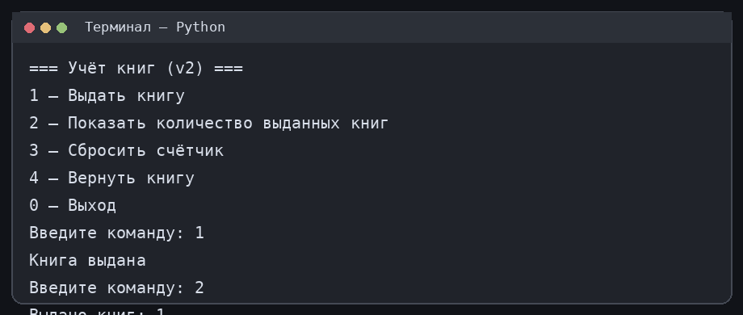
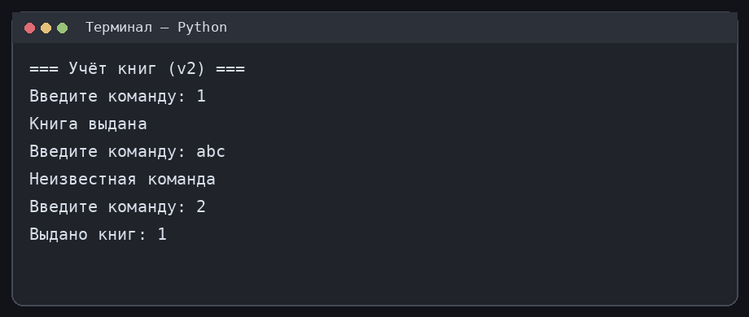

# Проект «Учёт книг»

Простая консольная программа на Python для учёта количества выданных книг. В версии `app_v2.py` добавлена команда возврата книги и проверка, чтобы счётчик не становился отрицательным.

## Файлы проекта

- `app_v1.py` — первая версия с командами выдачи, просмотра, сброса и выхода.
- `app_v2.py` — обновлённая версия с командой возврата.
- `otchet.md` — отчёт с 10 проверками регрессионного тестирования.
- `screenshots/` — два примера вывода консоли.

## Запуск

Установите Python 3. Запустите нужную версию из терминала в папке проекта:

```bash
python app_v1.py
```

или

```bash
python app_v2.py
```

## Меню

| Команда | Действие |
|---|---|
| `1` | Выдать одну книгу |
| `2` | Показать количество выданных книг |
| `3` | Сбросить счётчик до нуля |
| `4` | Вернуть книгу (только `v2`) |
| `0` | Завершить программу |

При вводе неизвестной команды программа сообщает «Неизвестная команда» и сохраняет счётчик.

## Скриншоты

### Обычная выдача книги


### Обработка неверного ввода


## Тестирование

Результаты проверок находятся в [otchet.md](otchet.md).
